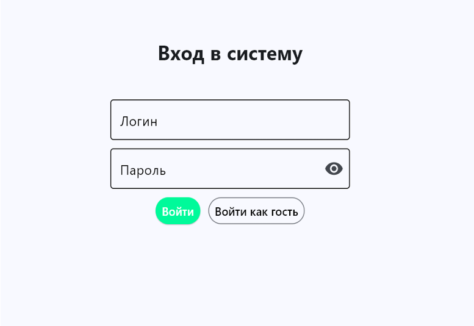
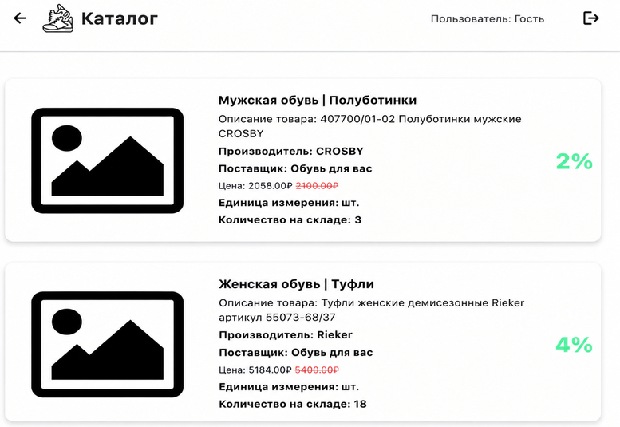

# Быстрый старт

**Разделы документации:**

[Главная](index.md) | [Быстрый старт](quick-start.md) | [Установка](installation.md) | [Руководство](user-guide.md) | [Справка](reference.md) | [Неисправности](troubleshooting.md)

---

На этой странице описан **быстрый запуск** приложения, если оно уже установлено и база данных настроена.

Если приложение **ещё не установлено**, перейдите к разделу [Установка и настройка](https://github.com/zmasa958-ship-it/practice-6/blob/main/installation.md).

## Запуск приложения

**Условие:** Python установлен, виртуальное окружение создано, зависимости установлены, файл `config.py` настроен, база данных `shoe_store` создана, служба PostgreSQL запущена.

**Действие:**

1. Перейдите в каталог проекта, например:

```
C:\Users\zaych\Downloads\mahazine
```

2. Активируйте виртуальное окружение:

```bat
venv\Scripts\activate
```

3. Запустите приложение:

```bat
python main.py
```

или используйте файл запуска (если он есть в проекте):

```bat
start_app.bat
```

**Ожидаемый результат:** после запуска откроется окно приложения с формой «Вход в систему» (поля «Логин», «Пароль», кнопки «Войти» и «Войти как гость»). Окно входа в систему показано на рисунке 1.

<p align="center"></p>
<p align="center">Рисунок 1 — Окно входа в систему</p>

## Вход в систему

**Условие:** приложение запущено, отображается форма входа.

**Действие:**

1. Введите логин и пароль и нажмите **«Войти»**  
   **или** нажмите **«Войти как гость»**.

**Ожидаемый результат:** отображается каталог товаров; нет сообщения об ошибке подключения к базе данных. Доступные действия зависят от [роли](reference.md#роли). Каталог товаров показан на рисунке 2.

<p align="center"></p>
<p align="center">Рисунок 2 — Каталог товаров</p>

---

[← Назад: Главная](index.md) | [Далее: Установка →](installation.md)
